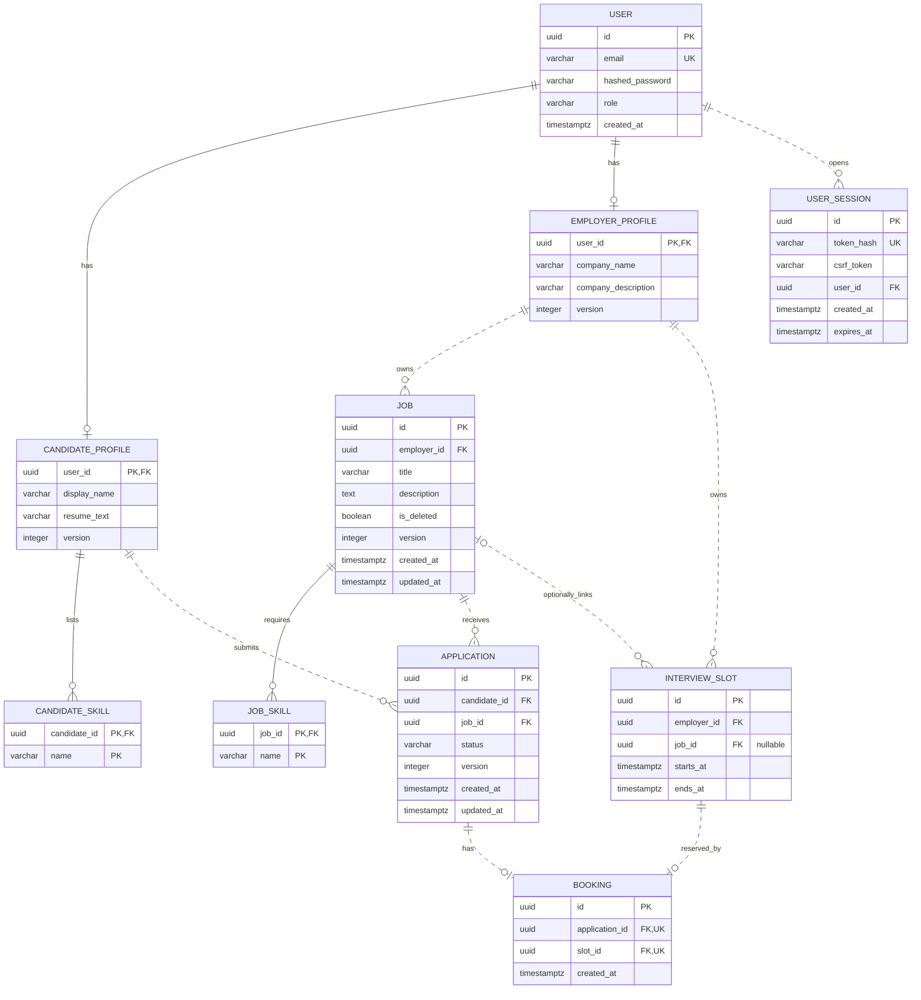

# Project Specification

## Product Scope

SkillMatch is a browser-based recruiting platform for candidates looking for jobs and employers managing their hiring pipeline. It covers the workflow from publishing a job and finding relevant openings through applying, reviewing applicants, and booking an interview.

- **Accounts and access.** Candidates and employers can register, sign in, and sign out. The server enforces role and ownership rules on protected actions.
- **Candidate workflow.** Candidates can maintain their own display name, technical skills, and private plain-text resume. They can browse all active jobs ranked by match score, open job details, and apply once per job. New applications start as `Pending`. Candidates can track their own application statuses and interview bookings. Resume access is restricted to the owner.
- **Employer workflow.** Employers can maintain their company profile and create, view, edit, and delete their own job postings. Deletion is blocked when a job has applications or linked interview slots. For each owned job, employers can review applicants ranked by match score, see their skills and bookings, and set each application to `Pending`, `Interviewing`, `Rejected`, or `Accepted`.
- **Skill matching.** Both rankings use the percentage of the job's required skills that the candidate has, rounded down to a whole number. A job with no required skills scores 100.
- **Interview scheduling.** Employers can publish future 30-minute slots shared across their jobs and remove future unbooked slots. A candidate can book one available slot from the job's employer for an owned `Interviewing` application. Both parties can see the confirmed booking. If two eligible candidates request the same slot concurrently, exactly one booking succeeds.

The application runs locally in a single Docker container that includes the web frontend, backend API, and a PostgreSQL database for persistent storage. The core workflows require no external AI service. PDF resume upload and extraction, LLM-generated match explanations or recommendations, and hosted deployment are outside the current product scope.

## Architecture

SkillMatch uses a React single-page application, a FastAPI backend, and PostgreSQL. The frontend renders pages and sends same-origin JSON requests to `/api/`. The backend validates requests and enforces authorization and business rules.

- **SQLModel** defines the relational models and provides sessions for reading and writing PostgreSQL data.
- **Alembic** tracks and applies database schema migrations.
- **Nginx** serves the built React app in Docker and forwards `/api/` requests to Uvicorn after removing the `/api` prefix.
- **Vite** serves the React app during local development and applies the same `/api/` rewrite when proxying requests to the backend.

The Docker entrypoint starts PostgreSQL and applies migrations before Supervisor launches Uvicorn and Nginx in the same container.

FastAPI registers four business routers in `backend/app/main.py`. Request and response schemas define the API payloads. Route dependencies check authentication and role where required, and services handle resource ownership, business rules, and database transactions.

- **`users`** manages registration, login, logout, sessions, and initial profile setup for both roles.
- **`candidate`** manages candidate profiles, job recommendations, applications, and candidate-side interview booking.
- **`employer`** manages company profiles, job postings, applicant rankings, and application status updates.
- **`interview`** manages employer availability, including creating, listing, and deleting slots. The candidate booking service uses the same slot and booking records.

Candidate recommendations and employer applicant rankings call the same `match_score` function in `backend/app/employer/matching.py`, so both calculate the same score for a given candidate and job.

## Data Model and Relationships

The application defines ten persistent SQLModel tables in PostgreSQL. Identifiers use UUIDs, and timestamps use `timestamptz`. `interview_slot.job_id` is the only nullable column. [Account and profile models](backend/app/users/model.py) · [Recruiting and scheduling models](backend/app/employer/model.py) · [Database migrations](backend/alembic/versions/)

| Model / table | Stored columns | Keys and constraints |
| --- | --- | --- |
| `User` / `user` | `id`, `email`, `hashed_password`, `role`, `created_at` | `id` is the primary key. `email` has a unique index. `role` is restricted to `candidate` or `employer`. |
| `UserSession` / `user_session` | `id`, `token_hash`, `csrf_token`, `user_id`, `created_at`, `expires_at` | `id` is the primary key. `token_hash` has a unique index and stores the SHA-256 digest of the session token. `user_id` references `user.id` with `ON DELETE CASCADE`. |
| `CandidateProfile` / `candidate_profile` | `user_id`, `display_name`, `resume_text`, `version` | `user_id` is both the primary key and a foreign key to `user.id`. `resume_text` holds the candidate's private plain-text resume. `version` is a positive integer with a database default of `1`. |
| `EmployerProfile` / `employer_profile` | `user_id`, `company_name`, `company_description`, `version` | `user_id` is both the primary key and a foreign key to `user.id`. This row stores the employer's company profile. `version` is a positive integer with a database default of `1`. |
| `CandidateSkill` / `candidate_skill` | `candidate_id`, `name` | The primary key is (`candidate_id`, `name`). `candidate_id` references `candidate_profile.user_id`. A check requires a nonempty, trimmed, lowercase skill name. |
| `Job` / `job` | `id`, `employer_id`, `title`, `description`, `is_deleted`, `version`, `created_at`, `updated_at` | `id` is the primary key. `employer_id` references `employer_profile.user_id`. The title and description must be nonempty after trimming. `is_deleted` marks a soft deletion. `version` is a positive integer with a database default of `1`. |
| `JobSkill` / `job_skill` | `job_id`, `name` | The primary key is (`job_id`, `name`). `job_id` references `job.id`. A check requires a nonempty, trimmed, lowercase skill name. A job may have zero required skills. |
| `Application` / `application` | `id`, `candidate_id`, `job_id`, `status`, `version`, `created_at`, `updated_at` | `id` is the primary key. `candidate_id` references `candidate_profile.user_id` and `job_id` references `job.id`. A unique constraint on (`candidate_id`, `job_id`) allows one application per candidate per job. `status` is restricted to `Pending`, `Interviewing`, `Rejected`, or `Accepted`. `version` is a positive integer with a database default of `1`. |
| `InterviewSlot` / `interview_slot` | `id`, `employer_id`, `job_id`, `starts_at`, `ends_at` | `id` is the primary key. `employer_id` references `employer_profile.user_id`. The optional `job_id` references `job.id`. A check requires `ends_at` to be later than `starts_at`. |
| `Booking` / `booking` | `id`, `application_id`, `slot_id`, `created_at` | `id` is the primary key. `application_id` references `application.id` and `slot_id` references `interview_slot.id`. Each foreign key has its own unique constraint, limiting each application and slot to one booking. |

- **Account and profile ownership.** An account can have multiple sessions and at most one row in each profile table. The server permits users to create the profile for their account role. `profile_completed` is derived from the presence of that profile.
- **Jobs and applications.** Each job belongs to one employer profile. `application` links candidates and jobs, allowing each candidate to apply to many jobs and each job to receive many applications. The application write path supplies `Pending` for new applications. The current migrations require an explicit `status` value for direct SQL inserts. The service blocks a job's soft deletion when it has applications or job-linked slots.
- **Skills and matching.** Candidate skills and job requirements are stored as individual rows. Match scores are calculated from those rows when needed. The `version` fields on `candidate_profile` and `job` protect updates to the parent records and their associated skills.
- **Interview availability and bookings.** An employer can own multiple slots. The slot creation service creates future, non-overlapping 30-minute slots and leaves `job_id` empty so slots are shared across that employer's jobs. Booking eligibility uses the employer of the job linked to the application. A slot's booked status comes from the presence of a `booking` row, which remains linked when the application status changes.

### Entity Relationship Diagram

`PK`, `FK`, and `UK` denote primary, foreign, and unique keys. The two `PK` marks on each skill table form a composite key. The table above lists the composite unique constraint on `application`.

## Authentication and Authorization

### User Login and Session Lifecycle

1. **Check credentials.** The browser sends `email`, `password`, and the optional `remember_me` flag as JSON to `/api/users/login`. FastAPI handles the request at `POST /users/login` and validates it with `UserLogin`. `authenticate_user` looks up the account by email and uses `pwdlib` to verify the stored salted Argon2 password hash. An unknown email or incorrect password returns the same `401 Invalid credentials` response. Invalid request fields return `422`.
2. **Create a server-side session.** Each successful login creates a new `user_session` row linked to the account. `create_session` generates a random 256-bit session token and an independent random CSRF token. The row stores the SHA-256 digest of the session token, the CSRF token, and a UTC expiration timestamp. By default, the session expires after 720 minutes, or after 30 days with `remember_me` enabled. [Session settings](backend/app/core/config.py)
3. **Set the cookies and return the account.** `session` contains the raw session token and is `HttpOnly`. `csrf_token` is readable by the frontend so it can copy the value into a request header. Both cookies use `Path=/` and `SameSite=Lax`, with `Secure` controlled by `COOKIE_SECURE`. Without `remember_me`, the cookies have no `Max-Age`. With it enabled, they use the configured session lifetime. The `200` JSON response contains `user` with `id`, `email`, `role`, and `profile_completed`, which is derived from the presence of the account's role-specific profile. The session token, CSRF token, and password hash are absent from the response body. [Login route and cookie setup](backend/app/users/router.py)
4. **Use, restore, or end the session.** `AuthContext` uses the login response to enter `/navpage` when the profile is complete or open the role-specific setup page. After a page reload, it calls `GET /api/users/me` to restore the account from the session cookie. `POST /users/logout` requires a valid session and matching CSRF header. On success it deletes the current session row, clears both cookies, and returns `204`. Subsequent protected requests using the deleted session token receive `401`. [Frontend authentication context](frontend/src/contexts/AuthContext.tsx)

The session service also provides `revoke_all_sessions` to delete every session for a given account. The `user_session.user_id` foreign key cascades session deletions when the account is deleted. [Session service](backend/app/users/service.py) · [Session model](backend/app/users/model.py)

Protected API requests with a missing, invalid, expired, or revoked session receive a JSON `401 Not authenticated` response. An authenticated request that fails a role or ownership check receives `403 Forbidden`. [Session and role checks](backend/app/users/service.py)

- **Opening or refreshing a protected page.** If the initial `GET /api/users/me` returns `401`, `AuthContext` clears the current user and `RequireAuth` redirects the browser to `/login`. [Authentication context](frontend/src/contexts/AuthContext.tsx) · [Route guard](frontend/src/components/RequireAuth.tsx)
- **Session loss while a business page is open.** A `401` from a business API becomes an `ApiError` handled by the page. For example, the candidate job list displays a sign-in prompt and stays on the current page. Reloading the page runs the session check again and redirects to `/login` if the session is still invalid. [Shared API client](frontend/src/api/common_api.ts) · [Candidate job list](frontend/src/pages/candidate/JobsPage.tsx)

An account can have several active sessions across browsers or devices. Each login creates an independent session with an expiration time fixed at creation. Logging out revokes the session presented by that browser. If users edit the same candidate profile or job concurrently, `candidate_profile.version` and `job.version` protect the parent records and their associated `candidate_skill` or `job_skill` rows from stale writes. [Session service](backend/app/users/service.py) · [Concurrent edit details pending](#design-decisions-and-limitations)

<!-- 指向下文详细描述 -->

### API Authentication and Authorization Dependencies

For a role-protected route, FastAPI resolves `get_valid_session`, then `require_csrf`, then `get_current_user`, and finally `require_candidate` or `require_employer`. A route can use `get_current_user` when either role may reach the handler or `require_csrf` when the handler needs the session row itself. The browser automatically sends cookies with same-origin requests. For `POST`, `PUT`, `PATCH`, and `DELETE`, the shared API client reads `csrf_token` and sends its value in `X-CSRF-Token`. [Backend dependencies](backend/app/users/service.py) · [Frontend API client](frontend/src/api/common_api.ts)

| Dependency | What it checks and returns |
| --- | --- |
| `get_valid_session` | Reads the configured session cookie with `APIKeyCookie`, hashes its value, and loads the matching session and account in one joined query. Returns `UserSession` for an unexpired session. A missing, unknown, or expired session returns `401 Not authenticated`. An expired session row is deleted when encountered. |
| `require_csrf` | Uses `APIKeyHeader` to read `X-CSRF-Token` and checks it against the validated session's stored CSRF token with a constant-time comparison for `POST`, `PUT`, `PATCH`, and `DELETE`. A missing or mismatched token returns `403 CSRF token missing or invalid`. On other methods, including `GET`, it returns the validated session without requiring the header. |
| `get_current_user` | Depends on `require_csrf` and returns the `User` loaded with the session. The authentication dependency does not issue another query to load the account. |
| `require_candidate` | Depends on `get_current_user` and requires the `candidate` role. A different role returns `403 Candidate role required`. |
| `require_employer` | Depends on `get_current_user` and requires the `employer` role. A different role returns `403 Employer role required`. |

| Route or route group | Route-level dependency |
| --- | --- |
| `POST /users/login`, `POST /users/register` | Public entry points that establish a session. They accept requests without an existing session or a CSRF header. |
| `POST /users/logout` | `require_csrf`, which supplies the `UserSession` to revoke. |
| `GET /users/me`, `GET /candidate/profiles/{candidate_id}` | `get_current_user`. The candidate profile service additionally restricts access to the owning candidate. |
| `POST /users/candidate/profile` and other `/candidate` routes | `require_candidate`. |
| `POST /users/employer/profile` and all `/employer` routes, including interview slot management | `require_employer`. |

The business services use the authenticated account to determine ownership. An ID supplied in a URL or request body selects a resource for the service to check. An ownership violation returns `403`, and an authorized lookup of a missing resource returns `404`. `409` indicates that the current resource state prevents the operation, while `422` indicates invalid input.
<!-- 这里等改完代码才能确定 -->
### Candidate Business Access

| Resource | Allowed operations | Authorization and limits |
| --- | --- | --- |
| Candidate profile and resume | Create, read, and edit the signed-in candidate's own profile, including display name, skills, and plain-text resume. | The server assigns ownership from the session. A second profile creation returns `409`. The profile-by-ID endpoint returns `403` to other candidates and to all employers, including the employer of a job the candidate applied to. |
| Job recommendations and details | Browse active jobs across employers and view each job's details and the caller's match score and application indicator. | A candidate profile is required. A missing profile or a request for a missing or soft-deleted job returns `404`. |
| Job applications | Apply to an active job and view the caller's own applications, statuses, and bookings. | Applying requires a candidate profile and creates a `Pending` application for the caller. A duplicate application returns `409`. The list filters by the caller's candidate ID. Reading another candidate's application returns `403`. Status changes are reserved for the employer who owns the job. |
| Interview slots and bookings | List available slots and book a slot through the caller's own application. | The application must be `Interviewing` and have no booking. A candidate can book a future, unbooked 30-minute slot owned by the job's employer. Using another candidate's application returns `403`. For an eligible application, selecting a slot owned by a different employer also returns `403`. An ineligible application state, an existing booking, or a slot that has started, is booked, or has the wrong duration returns `409`. |

The candidate service uses `_owned_application` for application detail, slot listing, and booking. The helper compares `application.candidate_id` against the authenticated account ID. [Candidate service](backend/app/candidate/service.py) · [Profile creation service](backend/app/users/service.py)

### Employer Business Access

| Resource | Allowed operations | Authorization and limits |
| --- | --- | --- |
| Company profile | Create, read, and edit the signed-in employer's own company profile. | The server uses the employer's account ID. A second profile creation returns `409`. Reading or editing before setup returns `404`. |
| Job postings | Publish jobs for the caller's company and list, view, edit, or soft-delete the caller's active jobs. | Publishing requires a company profile and returns `409` if it is missing. Accessing another employer's active job through the employer API returns `403`. Deleting a job with any application or a slot linked to that job returns `409`. |
| Applicants and application status | View applicants for an owned job and set an application to `Pending`, `Interviewing`, `Rejected`, or `Accepted`. | The list includes applicant IDs, display names, skills, scores, statuses, and bookings. Resume access stays with the candidate. Any of the four states may follow the current state, and the update preserves any existing booking. |
| Interview availability | Create and list the caller's own future slots, see whether they are booked, and delete future unbooked slots. | Creating a slot returns `404` if the employer profile is missing and `422` if the start time is invalid. The server assigns a 30-minute duration. Overlapping slots for the same employer return `409`. Deleting another employer's slot returns `403`. Deleting a booked or already-started slot returns `409`. |

The employer service uses `_load_owned_job` for job detail, edit, deletion, and applicant listing. For a status update, it follows `application.job_id` and compares `job.employer_id` with the caller's account ID. The interview service uses `interview_slot.employer_id` for slot ownership. [Employer service](backend/app/employer/service.py) · [Interview service](backend/app/interview/service.py)
<!-- 这里等改完代码才能确定 -->

### Candidate profile and job edit versions (2026-11-23)

`candidate_profile.version` and `job.version` are positive, non-null integers with
Python/database default 1, added through migration `7b2c9d4e6f10`. Existing data is
preserved. Creation assigns version 1 and rejects a client-supplied version.
Profile, job and derived recommended-job responses include version.

`PATCH /candidate/profile` and `PATCH /employer/jobs/{id}` require a strict positive
integer `version`; missing/null/bool/string/non-positive values return 422. Existing
authentication, ownership and missing-resource errors precede stale-version checks.
The service locks and refreshes the parent row, compares version, then updates
fields/skill rows and increments version in one transaction. A stale edit returns
409 with `{"detail":"Resource version conflict"}` and makes no changes. A version-only
request checks freshness but changes neither revision nor update timestamp; any
request containing an editable field increments version once even for equal values.
Failed transactions roll back content and version. Response DTOs are captured
inside the transaction and returned only after commit succeeds.

Editors retain the loaded version and all draft values when rejected. Save stays
disabled until the user confirms discarding the draft and a fresh GET succeeds.
Cancel or load failure preserves the draft and conflict state. There is no automatic
merge, force-save, retry, WebSocket or BroadcastChannel synchronization. HTTP JSON
fetch and Cookie/CSRF authentication are retained; clients without versions must
upgrade rather than use an unprotected fallback.

### Company profile, application status and explicit update checks (2026-11-23)

Migration `8c3d0e5f7a21`, following `7b2c9d4e6f10`, adds positive, non-null
`version` columns (Python/database default 1) to `employer_profile` and
`application`, preserving existing data. Employer-profile creation and company,
applicant-list, candidate-application and status-update responses include version.
Company creation rejects client-supplied versions; applying creates version 1.

`PATCH /employer/company` and `PATCH /employer/applications/{id}/status` now
require the same strict positive `version` and 409 conflict contract above.
The company parent / application row remains locked through commit; fresh ORM
values are loaded before comparison and response DTOs are captured before commit.
Company fields preserve omission/clearing rules; a version-only company request
is a no-op. Status updates still require `status`, allow all four existing values,
and increment once even for the same value. Role, ownership and missing-resource
checks precede version comparison. Booking links survive status updates; booking,
creation and deletion actions keep their existing atomic contracts.

All four editors have a **Check for updates** button beside Save. It performs a
GET without writing. An unchanged version preserves every input, including skill
search text. A changed version applies immediately only when there is no draft;
otherwise explicit discard confirmation is required. Cancelling preserves the old
draft/version and disables Save. Read failure retains the draft and allows retry.
Confirmed application changes one applicant card only, keeping other cards' drafts
and loaded versions intact. A typed but unadded skill query counts as a draft.
Checking never advances the version of a draft that the user chose to keep.
New-job creation has no update-check button because no saved resource exists yet.

## API Routes or Server Actions

The tables list all 28 application API operations using their FastAPI paths. Browser clients prepend `/api`, so `GET /candidate/jobs` is requested as `GET /api/candidate/jobs`. Resource IDs in path parameters are UUIDs. Request bodies use JSON, `[]` denotes an array response, and `204 No Content` has no response body. Session cookies, CSRF headers, and resource ownership are described in [Authentication and Authorization](#authentication-and-authorization).

### Accounts and profile setup

Registration and login establish a session and set the session and CSRF cookies. Either role can read its own account or end its session. Profile setup requires the matching account role. [Account router](backend/app/users/router.py) · [Account schemas](backend/app/users/schema.py)

| Operation | JSON request | Success | Behavior |
| --- | --- | --- | --- |
| `POST /users/register` | `email`, `password`, `role` (`candidate` or `employer`) | `200` `AuthResponse` | Create an account and start its session. A duplicate email returns `400`. |
| `POST /users/login` | `email`, `password`, optional `remember_me` | `200` `AuthResponse` | Verify credentials and create a new session. Invalid credentials return `401`. |
| `POST /users/logout` | — | `204` No Content | Revoke the current session and clear both cookies. |
| `GET /users/me` | — | `200` `UserPublic` | Return the authenticated account and its `profile_completed` flag. |
| `POST /users/candidate/profile` | `display_name`, optional `resume_text` and `skills` | `201` `CandidateProfilePublic` | Create the caller's candidate profile. A repeated setup request returns `409`. |
| `POST /users/employer/profile` | `company_name`, optional `company_description` | `201` `EmployerProfilePublic` | Create the caller's company profile. A repeated setup request returns `409`. |

### Candidate

These operations require the candidate role. The profile-by-ID endpoint accepts an authenticated account at the router and checks in the service that the caller is the candidate who owns the profile. [Candidate router](backend/app/candidate/router.py) · [Candidate schemas](backend/app/candidate/schema.py)

| Operation | JSON request | Success | Behavior |
| --- | --- | --- | --- |
| `GET /candidate/profile` | — | `200` `CandidateProfilePublic` | Read the caller's profile, skills, and private resume. |
| `PATCH /candidate/profile` | `version` and any of `display_name`, `resume_text`, `skills` | `200` `CandidateProfilePublic` | Update the caller's profile and replace the skills list when supplied. A stale version returns `409`. |
| `GET /candidate/profiles/{candidate_id}` | — | `200` `CandidateProfilePublic` | Read a profile by candidate ID. Access is restricted to the owner. |
| `GET /candidate/jobs` | — | `200` `RecommendedJob[]` | List all active jobs by descending match score with the caller's application indicator. |
| `GET /candidate/jobs/{job_id}` | — | `200` `RecommendedJob` | View an active job and the caller's match score and application indicator. |
| `POST /candidate/jobs/{job_id}/applications` | Omitted or `{}` | `201` `ApplicationPublic` | Apply to the job as the caller. New applications start as `Pending`. A duplicate returns `409`. |
| `GET /candidate/applications` | — | `200` `ApplicationPublic[]` | List the caller's applications with their statuses and any bookings. |
| `GET /candidate/applications/{application_id}` | — | `200` `ApplicationPublic` | View one of the caller's applications and its booking, if any. |
| `GET /candidate/applications/{application_id}/slots` | — | `200` `SlotPublic[]` | List bookable slots for an eligible application owned by the caller. |
| `POST /candidate/applications/{application_id}/booking` | `slot_id` | `201` `BookingPublic` | Book a slot for the caller's eligible application. A slot already booked by another request returns `409 Slot already booked`. |
<!-- 还没看 -->
### Employer

These operations require the employer role. Job and applicant operations are scoped to the caller's company and job ownership. [Employer router](backend/app/employer/router.py) · [Employer schemas](backend/app/employer/schema.py)

| Operation | JSON request | Success | Behavior |
| --- | --- | --- | --- |
| `GET /employer/company` | — | `200` `CompanyPublic` | Read the caller's company profile. |
| `PATCH /employer/company` | `version` and any of `company_name`, `company_description` | `200` `CompanyPublic` | Update the supplied company profile fields. A stale version returns `409`. |
| `POST /employer/jobs` | `title`, `description`, optional `required_skills` | `201` `JobPublic` | Publish a job for the caller's company. Publishing before company setup returns `409`. |
| `GET /employer/jobs` | — | `200` `JobPublic[]` | List the caller's active job postings. |
| `GET /employer/jobs/{job_id}` | — | `200` `JobPublic` | Read an active job owned by the caller. |
| `PATCH /employer/jobs/{job_id}` | `version` and any of `title`, `description`, `required_skills` | `200` `JobPublic` | Update an owned job and replace required skills when supplied. A stale version returns `409`. |
| `DELETE /employer/jobs/{job_id}` | — | `204` No Content | Soft-delete an owned job. Existing applications or job-linked slots cause `409`. |
| `GET /employer/jobs/{job_id}/applications` | — | `200` `ApplicantPublic[]` | List applicants for an owned job by descending match score, with their skills, statuses, and bookings. |
| `PATCH /employer/applications/{application_id}/status` | `version`, `status` (`Pending`, `Interviewing`, `Rejected`, or `Accepted`) | `200` `ApplicationStatusPublic` | Change an application status for an owned job and retain any existing booking. A stale version returns `409`. |

### Employer interview slots

These operations require the employer role and apply to the caller's own availability. Booking eligibility and transaction behavior are documented in [Interview Scheduling and Booking Transaction](#interview-scheduling-and-booking-transaction). [Interview router](backend/app/interview/router.py) · [Interview schemas](backend/app/interview/schema.py)

| Operation | JSON request | Success | Behavior |
| --- | --- | --- | --- |
| `POST /employer/interview-slots` | `starts_at` as an ISO 8601 timestamp with `Z` or a UTC offset | `201` `SlotPublic` | Create a future 30-minute slot. An overlapping slot returns `409`. |
| `GET /employer/interview-slots` | — | `200` `ManagedSlotPublic[]` | List the caller's future slots with an `is_booked` flag. |
| `DELETE /employer/interview-slots/{slot_id}` | — | `204` No Content | Delete an owned future slot. A booked or already-started slot returns `409`. |

## User Interface and Workflows

## Matching Algorithm and Skill Storage

## Interview Scheduling and Booking Transaction

### 雇主时段管理

[interview 模块](backend/app/interview/PLAN.md)提供三个雇主接口。在 `backend/app/interview/` 下，`router.py` 处理 HTTP，`schema.py` 校验请求及定义响应，`service.py` 执行业务与事务。路由由 `backend/app/main.py` 注册。

| 接口 | 请求与成功响应 | 业务错误 |
| --- | --- | --- |
| `POST /employer/interview-slots` | 请求体只含 `starts_at`，服务端加 30 分钟得出 `ends_at`。创建成功返回 `201` 和 `{id, starts_at, ends_at}`。 | 雇主资料缺失返回 `404`。与本人已有时段重叠返回 `409`。额外字段或时间非法返回 `422`。 |
| `GET /employer/interview-slots` | 返回本雇主尚未开始的所有时段，含 `is_booked`，按 `starts_at`、`id` 排序。返回 `200`，无时段时为 `[]`。 | 适用统一认证和角色校验。 |
| `DELETE /employer/interview-slots/{slot_id}` | 用 UUID 标识时段，删除本雇主的未来空闲时段，成功返回 `204`。 | UUID 格式非法返回 `422`，时段不存在返回 `404`，属于其他雇主返回 `403`，已预约或已开始返回 `409`。 |

- **权限** 使用 `require_employer` 核验服务端会话。未登录返回 `401`，候选人访问返回 `403`。创建和删除还需通过 `X-CSRF-Token` 校验。列表限定 `employer_id = current_user.id`，创建也从当前登录用户取得 `employer_id`。
- **时间** `starts_at` 为带 `Z` 或 UTC 偏移量的 ISO 8601 字符串（如 `2026-12-01T09:00:00+08:00`）。服务端归一为 UTC，确认开始时间晚于当前时间后加 30 分钟。数据库使用 `timestamptz`，接口以 UTC 返回时间，新管理页面按 `Asia/Shanghai` 标注和展示。
- **重叠** 按同一雇主判断，已预约时段也占用时间。两个时段首尾相接时可以创建。
- **数据** 复用 `interview_slot` 与 `booking`。新时段由雇主跨职位共享，现有可空 `job_id` 在创建时留空。时段是否已被预约以 `booking.slot_id` 为准。

### 候选人资格与可见性

复用现有候选人时段列表与预约接口。只有申请本人能通过处于 `Interviewing` 且尚未预约的申请，查看和预约该职位所属雇主未来、空闲的 30 分钟时段。雇主时段管理页显示已预约时段并禁用删除。预约结果通过候选人申请和雇主本人职位的申请人列表分别展示。

列表查询以查询时的数据库状态为准。雇主用 `EXISTS` 获取预约状态，候选人的可预约列表排除已有预约的时段。删除与预约在写入事务中重新检查条件。

### 事务与行锁

1. **创建时段** 事务先锁定雇主资料行，再查询重叠并插入。按 `READ COMMITTED`，等待锁的同一雇主请求会看到前一请求提交的时段。
2. **删除时段** 在 PostgreSQL 事务中用 `SELECT … FOR UPDATE` 锁住时段行。确认归属后，在持锁状态下检查预约和开始时间，再删除并提交。失败时回滚，保留时段和关联数据。
3. **创建预约** 沿用申请行、时段行的加锁顺序，持锁检查资格后写入预约。删除只锁时段行。按 `READ COMMITTED` 在获得时段锁后查询 `booking`，可看到先提交的预约。预约先提交时删除返回 `409`，删除先提交时预约返回 `404`。
4. **并发约束** `booking.application_id` 和 `booking.slot_id` 分别唯一，外键保护预约引用的时段。两名符合资格的候选人竞争同一时段时，一方成功，另一方收到 `409` 和 `Slot already booked`，数据库保留一条预约。

### 申请状态流转

新申请默认为 `Pending`，见 [FP-CAN-3](docs/REQUIREMENTS.md#fp-can-3-applications)。[FP-EMP-3](docs/REQUIREMENTS.md#fp-emp-3-applicant-management)规定了四个合法状态 `Pending`、`Interviewing`、`Rejected`、`Accepted`，并规定只有职位所属雇主能修改。课程未规定状态流转顺序，现有实现允许直接从 `Pending` 改为 `Accepted`。

[FP-SCHED-2](docs/REQUIREMENTS.md#fp-sched-2-booking-eligibility)把 `Interviewing` 设为创建预约的前提。已有预约的申请改为 `Accepted` 或其他状态后，预约继续关联原申请，时段继续占用。状态更新与预约共用申请行锁。

## Security Controls

## Optional AI Features and Data Flow

## Design Decisions and Limitations

## Candidate Integration (2026-11-05)

Candidate routes use the existing users/employer SQLModel tables and Alembic chain.
The matching implementation is `backend/app/employer/matching.py::match_score`,
called directly by both workflows. Skills are normalized using the existing
`normalize_skills` function and stored in CandidateSkill/JobSkill rows. Resume text
does not participate in matching. Candidate ties use lowercase job title, then ID.

Candidate profile updates, applications and bookings live in a schema/service/router
module. Booking locks the application before the slot; the existing two unique
constraints enforce one booking per application and slot. Responses use UTC,
and candidate pages display Asia/Shanghai. State changes preserve existing bookings.

The original relationship-based resume exception was superseded by the user's
owner-only policy and teammate commit `5143f1e`. Employers cannot read raw resumes.

API contracts, test commands and known integration boundaries are documented in
[CANDIDATE_REBUILD.md](docs/completed/CANDIDATE_REBUILD.md). No old candidate database or API
compatibility layer is included. Employer slot management remains outside this change.
