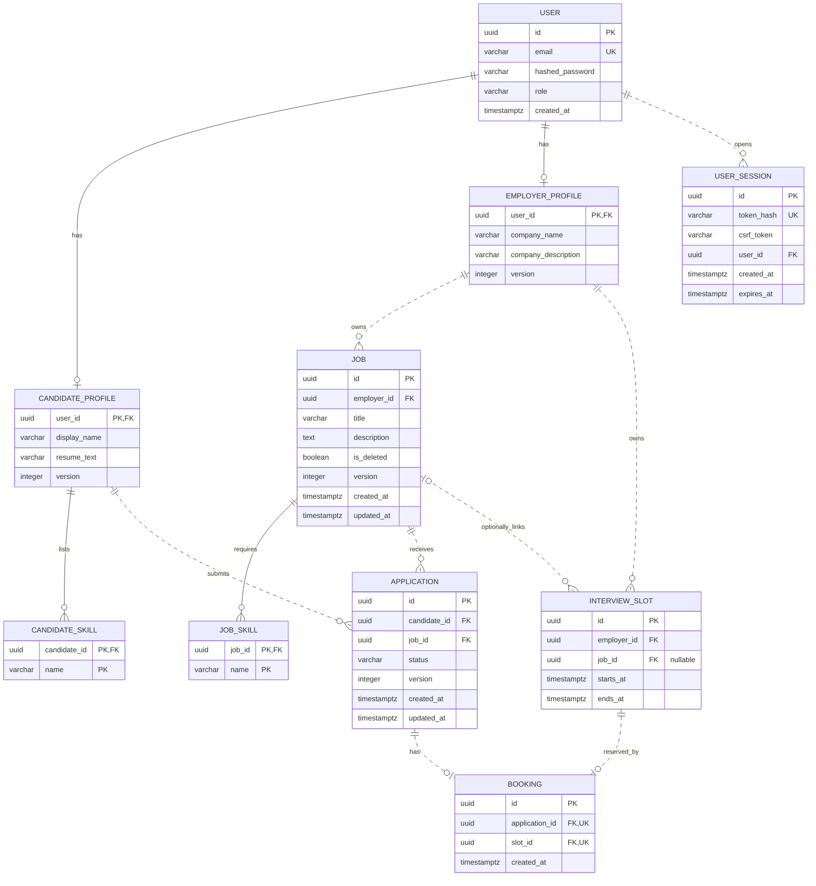

# Project Specification

## Product Scope

SkillMatch is a browser-based recruiting platform for candidates looking for jobs and employers managing their hiring pipeline. It covers the workflow from publishing a job and finding relevant openings through applying, reviewing applicants, and booking an interview.

- **Accounts and access.** Candidates and employers can register, sign in, and sign out. The server enforces role and ownership rules on protected actions.
- **Candidate workflow.** Candidates can maintain their own display name, technical skills, and private plain-text resume. They can browse all active jobs ranked by match score, open job details, and apply once per job. New applications start as `Pending`. Candidates can track their own application statuses and interview bookings. Resume access is restricted to the owner.
- **Employer workflow.** Employers can maintain their company profile and create, view, edit, and delete their own job postings. Deletion is blocked when a job has applications or linked interview slots. For each owned job, employers can review applicants ranked by match score, see their skills and bookings, and set each application to `Pending`, `Interviewing`, `Rejected`, or `Accepted`.
- **Skill matching.** Both rankings use the percentage of the job's required skills that the candidate has, rounded down to a whole number. A job with no required skills scores 100.
- **Interview scheduling.** Employers can publish future 30-minute slots shared across their jobs until booked and remove future unbooked slots. A candidate can book one eligible slot for an owned `Interviewing` application. Booking assigns the slot to that application’s job and makes the booking visible to both parties. If two eligible candidates request the same slot concurrently, exactly one booking succeeds.

The application runs locally in a single Docker container that includes the web frontend, backend API, and a PostgreSQL database for persistent storage. The core workflows require no external AI service. PDF resume upload and extraction, LLM-generated match explanations or recommendations, and hosted deployment are outside the current product scope.

## Architecture

SkillMatch uses a React single-page application, a FastAPI backend, and PostgreSQL. The frontend renders pages and sends same-origin JSON requests to `/api/`. The backend validates requests and enforces authorization and business rules.

- **SQLModel** defines the relational models and provides sessions for reading and writing PostgreSQL data.
- **Alembic** tracks and applies database schema migrations.
- **Nginx** serves the built React app in Docker and forwards `/api/` requests to Uvicorn after removing the `/api` prefix.
- **Vite** serves the React app during local development and applies the same `/api/` rewrite when proxying requests to the backend.

The Docker entrypoint starts PostgreSQL and applies migrations before Supervisor launches Uvicorn and Nginx in the same container.

FastAPI registers four business routers in `backend/app/main.py`. Request and response schemas define the API payloads. Route dependencies check authentication and role where required, and services handle resource ownership, business rules, and database transactions.

- **`users`** manages registration, login, logout, sessions, and initial profile setup for both roles.
- **`candidate`** manages candidate profiles, job recommendations, applications, and candidate-side interview booking.
- **`employer`** manages company profiles, job postings, applicant rankings, and application status updates.
- **`interview`** manages employer availability, including creating, listing, and deleting slots. The candidate booking service uses the same slot and booking records.

Candidate recommendations and employer applicant rankings call the same `match_score` function in `backend/app/employer/matching.py`, so both calculate the same score for a given candidate and job.

## Data Model and Relationships

The application defines ten persistent SQLModel tables in PostgreSQL. Identifiers use UUIDs, and timestamps use `timestamptz`. `interview_slot.job_id` is the only nullable column. [Account and profile models](backend/app/users/model.py) · [Recruiting and scheduling models](backend/app/employer/model.py) · [Database migrations](backend/alembic/versions/)

| Model / table | Stored columns | Keys and constraints |
| --- | --- | --- |
| `User` / `user` | `id`, `email`, `hashed_password`, `role`, `created_at` | `id` is the primary key. `email` has a unique index. `role` is restricted to `candidate` or `employer`. |
| `UserSession` / `user_session` | `id`, `token_hash`, `csrf_token`, `user_id`, `created_at`, `expires_at` | `id` is the primary key. `token_hash` has a unique index and stores the SHA-256 digest of the session token. `user_id` references `user.id` with `ON DELETE CASCADE`. |
| `CandidateProfile` / `candidate_profile` | `user_id`, `display_name`, `resume_text`, `version` | `user_id` is both the primary key and a foreign key to `user.id`. `resume_text` holds the candidate's private plain-text resume. `version` is a positive integer with a database default of `1`. |
| `EmployerProfile` / `employer_profile` | `user_id`, `company_name`, `company_description`, `version` | `user_id` is both the primary key and a foreign key to `user.id`. This row stores the employer's company profile. `version` is a positive integer with a database default of `1`. |
| `CandidateSkill` / `candidate_skill` | `candidate_id`, `name` | The primary key is (`candidate_id`, `name`). `candidate_id` references `candidate_profile.user_id`. A check requires a nonempty, trimmed, lowercase skill name. |
| `Job` / `job` | `id`, `employer_id`, `title`, `description`, `is_deleted`, `version`, `created_at`, `updated_at` | `id` is the primary key. `employer_id` references `employer_profile.user_id`. The title and description must be nonempty after trimming. `is_deleted` marks a soft deletion. `version` is a positive integer with a database default of `1`. |
| `JobSkill` / `job_skill` | `job_id`, `name` | The primary key is (`job_id`, `name`). `job_id` references `job.id`. A check requires a nonempty, trimmed, lowercase skill name. A job may have zero required skills. |
| `Application` / `application` | `id`, `candidate_id`, `job_id`, `status`, `version`, `created_at`, `updated_at` | `id` is the primary key. `candidate_id` references `candidate_profile.user_id` and `job_id` references `job.id`. A unique constraint on (`candidate_id`, `job_id`) allows one application per candidate per job. `status` is restricted to `Pending`, `Interviewing`, `Rejected`, or `Accepted`. `version` is a positive integer with a database default of `1`. |
| `InterviewSlot` / `interview_slot` | `id`, `employer_id`, `job_id`, `starts_at`, `ends_at` | `id` is the primary key. `employer_id` references `employer_profile.user_id`. The optional `job_id` references `job.id`. A check requires `ends_at` to be later than `starts_at`. |
| `Booking` / `booking` | `id`, `application_id`, `slot_id`, `created_at` | `id` is the primary key. `application_id` references `application.id` and `slot_id` references `interview_slot.id`. Each foreign key has its own unique constraint, limiting each application and slot to one booking. |

- **Account and profile ownership.** An account can have multiple sessions and at most one row in each profile table. The server permits users to create the profile for their account role. `profile_completed` is derived from the presence of that profile.
- **Jobs and applications.** Each job belongs to one employer profile. `application` links candidates and jobs, allowing each candidate to apply to many jobs and each job to receive many applications. The application write path supplies `Pending` for new applications. Migration `9d6e1a4b2c30` also sets the database default to `Pending`, so direct SQL inserts may omit `status` after that migration is applied. The service blocks a job's soft deletion when it has applications or job-linked slots.
- **Skills and matching.** Candidate skills and job requirements are stored as individual rows. Match scores are calculated from those rows when needed. The `version` fields on `candidate_profile` and `job` protect updates to the parent records and their associated skills.
- **Interview availability and bookings.** An employer can own multiple slots. The slot creation service creates future, non-overlapping 30-minute slots with an empty `job_id`. A slot is eligible when the employer owns it and its `job_id` is empty or matches the application’s job. The booking transaction assigns that job to the slot and inserts the `booking` row. The booking determines whether the slot is booked and stays linked through application status changes. The employer's slot list can derive the job from the application for older bookings with an empty slot `job_id`.

### Entity Relationship Diagram

`PK`, `FK`, and `UK` denote primary, foreign, and unique keys. The two `PK` marks on each skill table form a composite key. The table above lists the composite unique constraint on `application`.

## Authentication and Authorization

### User Login and Session Lifecycle

1. **Check credentials.** The browser sends `email`, `password`, and the optional `remember_me` flag as JSON to `/api/users/login`. FastAPI handles the request at `POST /users/login` and validates it with `UserLogin`. `authenticate_user` looks up the account by email and uses `pwdlib` to verify the stored salted Argon2 password hash. An unknown email or incorrect password returns the same `401 Invalid credentials` response. Invalid request fields return `422`.
2. **Create a server-side session.** Each successful login creates a new `user_session` row linked to the account. `create_session` generates a random 256-bit session token and an independent random CSRF token. The row stores the SHA-256 digest of the session token, the CSRF token, and a UTC expiration timestamp. By default, the session expires after 720 minutes, or after 30 days with `remember_me` enabled. [Session settings](backend/app/core/config.py)
3. **Set the cookies and return the account.** `session` contains the raw session token and is `HttpOnly`. `csrf_token` is readable by the frontend so it can copy the value into a request header. Both cookies use `Path=/` and `SameSite=Lax`, with `Secure` controlled by `COOKIE_SECURE`. Without `remember_me`, the cookies have no `Max-Age`. With it enabled, they use the configured session lifetime. The `200` JSON response contains `user` with `id`, `email`, `role`, and `profile_completed`, which is derived from the presence of the account's role-specific profile. The session token, CSRF token, and password hash are absent from the response body. [Login route and cookie setup](backend/app/users/router.py)
4. **Use, restore, or end the session.** `AuthContext` uses the login response to enter `/navpage` when the profile is complete or open the role-specific setup page. After a page reload, it calls `GET /api/users/me` to restore the account from the session cookie. `POST /users/logout` requires a valid session and matching CSRF header. On success it deletes the current session row, clears both cookies, and returns `204`. Subsequent protected requests using the deleted session token receive `401`. [Frontend authentication context](frontend/src/contexts/AuthContext.tsx)

The session service also provides `revoke_all_sessions` to delete every session for a given account. The `user_session.user_id` foreign key cascades session deletions when the account is deleted. [Session service](backend/app/users/service.py) · [Session model](backend/app/users/model.py)

Protected API requests with a missing, invalid, expired, or revoked session receive a JSON `401 Not authenticated` response. An authenticated request that fails a role or ownership check receives `403 Forbidden`. [Session and role checks](backend/app/users/service.py)

- **Opening or refreshing a protected page.** If the initial `GET /api/users/me` returns `401`, `AuthContext` clears the current user and `RequireAuth` redirects the browser to `/login`. [Authentication context](frontend/src/contexts/AuthContext.tsx) · [Route guard](frontend/src/components/RequireAuth.tsx)
- **Session loss while a business page is open.** A `401` from a business API becomes an `ApiError` handled by the page. For example, the candidate job list displays a sign-in prompt and stays on the current page. Reloading the page runs the session check again and redirects to `/login` if the session is still invalid. [Shared API client](frontend/src/api/common_api.ts) · [Candidate job list](frontend/src/pages/candidate/JobsPage.tsx)
- **Signing out from a protected page.** The browser clears its current user and redirects to `/login` when `POST /api/users/logout` returns `204` or `401`. After any other error or a network failure, the browser checks `GET /api/users/me`. A `401` confirms the session ended and triggers the same redirect. If the account is still signed in or the check fails, the browser keeps the current page and offers a retry. [Frontend authentication context](frontend/src/contexts/AuthContext.tsx)

An account can have several active sessions across browsers or devices. Each login creates an independent session with an expiration time fixed at creation. Logging out revokes the session presented by that browser. Concurrent edits across sessions are subject to the same version checks. [Session service](backend/app/users/service.py) · [Version-protected edits](#version-protected-edits)

### API Authentication and Authorization Dependencies

For a role-protected route, FastAPI resolves `get_valid_session`, then `require_csrf`, then `get_current_user`, and finally `require_candidate` or `require_employer`. A route can use `get_current_user` when either role may reach the handler or `require_csrf` when the handler needs the session row itself. The browser automatically sends cookies with same-origin requests. For `POST`, `PUT`, `PATCH`, and `DELETE`, the shared API client reads `csrf_token` and sends its value in `X-CSRF-Token`. [Backend dependencies](backend/app/users/service.py) · [Frontend API client](frontend/src/api/common_api.ts)

| Dependency | What it checks and returns |
| --- | --- |
| `get_valid_session` | Reads the configured session cookie with `APIKeyCookie`, hashes its value, and loads the matching session and account in one joined query. Returns `UserSession` for an unexpired session. A missing, unknown, or expired session returns `401 Not authenticated`. An expired session row is deleted when encountered. |
| `require_csrf` | Uses `APIKeyHeader` to read `X-CSRF-Token` and checks it against the validated session's stored CSRF token with a constant-time comparison for `POST`, `PUT`, `PATCH`, and `DELETE`. A missing or mismatched token returns `403 CSRF token missing or invalid`. On other methods, including `GET`, it returns the validated session without requiring the header. |
| `get_current_user` | Depends on `require_csrf` and returns the `User` loaded with the session. The authentication dependency does not issue another query to load the account. |
| `require_candidate` | Depends on `get_current_user` and requires the `candidate` role. A different role returns `403 Candidate role required`. |
| `require_employer` | Depends on `get_current_user` and requires the `employer` role. A different role returns `403 Employer role required`. |

| Route or route group | Route-level dependency |
| --- | --- |
| `POST /users/login`, `POST /users/register` | Public entry points that establish a session. They accept requests without an existing session or a CSRF header. |
| `POST /users/logout` | `require_csrf`, which supplies the `UserSession` to revoke. |
| `GET /users/me`, `GET /candidate/profiles/{candidate_id}` | `get_current_user`. The candidate profile service additionally restricts access to the owning candidate. |
| `POST /users/candidate/profile` and other `/candidate` routes | `require_candidate`. |
| `POST /users/employer/profile` and all `/employer` routes, including interview slot management | `require_employer`. |

The business services use the authenticated account to determine ownership. An ID supplied in a URL or request body selects a resource for the service to check. An ownership violation returns `403`, and an authorized lookup of a missing resource returns `404`. `409` indicates that the current resource state prevents the operation, while `422` indicates invalid input.

### Candidate Business Access

| Resource | Allowed operations | Authorization and limits |
| --- | --- | --- |
| Candidate profile and resume | Create, read, and edit the signed-in candidate's own profile, including display name, skills, and plain-text resume. | The server assigns ownership from the session. A second profile creation returns `409`. The profile-by-ID endpoint returns `403` to other candidates and to all employers, including the employer of a job the candidate applied to. |
| Job recommendations and details | Browse active jobs across employers and view each job's details and the caller's match score and application indicator. | A candidate profile is required. A missing profile or a request for a missing or soft-deleted job returns `404`. |
| Job applications | Apply to an active job and view the caller's own applications, statuses, and bookings. | Applying requires a candidate profile and creates a `Pending` application for the caller. A duplicate application returns `409`. The list filters by the caller's candidate ID. Reading another candidate's application returns `403`. Status changes are reserved for the employer who owns the job. |
| Interview slots and bookings | List available slots and book a slot through the caller's own application. | The application must be `Interviewing` and have no booking. A slot must be future, unbooked, and 30 minutes long. The slot must belong to the job's employer and have an empty `job_id` or match the application’s job. Another candidate's application or another employer's slot returns `403`. An ineligible application state, an existing booking, or a slot that has started, is booked, has the wrong duration, or is reserved for another job returns `409`. |

The candidate service uses `_owned_application` for application detail, slot listing, and booking. The helper compares `application.candidate_id` against the authenticated account ID. [Candidate service](backend/app/candidate/service.py) · [Profile creation service](backend/app/users/service.py)

### Employer Business Access

| Resource | Allowed operations | Authorization and limits |
| --- | --- | --- |
| Company profile | Create, read, and edit the signed-in employer's own company profile. | The server uses the employer's account ID. A second profile creation returns `409`. Reading or editing before setup returns `404`. |
| Job postings | Publish jobs for the caller's company and list, view, edit, or soft-delete the caller's active jobs. | Publishing requires a company profile and returns `409` if it is missing. Accessing another employer's active job through the employer API returns `403`. Deleting a job with any application or a slot linked to that job returns `409`. |
| Applicants and application status | View applicants for an owned job and set an application to `Pending`, `Interviewing`, `Rejected`, or `Accepted`. | The list includes applicant IDs, display names, account emails, skills, scores, statuses, and bookings. Emails help the job owner distinguish applicants who share a display name. Resume access stays with the candidate. Any of the four states may follow the current state, and the update preserves any existing booking. |
| Interview availability | Create and list the caller's own future slots, see whether they are booked, and delete future unbooked slots. | Creating a slot returns `404` if the employer profile is missing and `422` if the start time is invalid. The server assigns a 30-minute duration. Overlapping slots for the same employer return `409`. Deleting another employer's slot returns `403`. Deleting a booked or already-started slot returns `409`. |

The employer service uses `_load_owned_job` for job detail, edit, deletion, and applicant listing. For a status update, it follows `application.job_id` and compares `job.employer_id` with the caller's account ID. The interview service uses `interview_slot.employer_id` for slot ownership. [Employer service](backend/app/employer/service.py) · [Interview service](backend/app/interview/service.py)

## API Routes or Server Actions

The tables list all 28 application API operations using their FastAPI paths. Browser clients prepend `/api`, so `GET /candidate/jobs` is requested as `GET /api/candidate/jobs`. Resource IDs in path parameters are UUIDs. Request bodies use JSON, `[]` denotes an array response, and `204 No Content` has no response body. Session cookies, CSRF headers, and resource ownership are described in [Authentication and Authorization](#authentication-and-authorization).

### Accounts and profile setup

Registration and login establish a session and set the session and CSRF cookies. Either role can read its own account or end its session. Profile setup requires the matching account role. [Account router](backend/app/users/router.py) · [Account schemas](backend/app/users/schema.py)

| Operation | JSON request | Success | Behavior |
| --- | --- | --- | --- |
| `POST /users/register` | `email`, `password`, `role` (`candidate` or `employer`) | `200` `AuthResponse` | Create an account and start its session. If the initial lookup finds the email, return `400` with `User already exists`. |
| `POST /users/login` | `email`, `password`, optional `remember_me` | `200` `AuthResponse` | Verify credentials and create a new session. Invalid credentials return `401`. |
| `POST /users/logout` | — | `204` No Content | Revoke the current session and clear both cookies. |
| `GET /users/me` | — | `200` `UserPublic` | Return the authenticated account and its `profile_completed` flag. |
| `POST /users/candidate/profile` | `display_name`, optional `resume_text` and `skills` | `201` `CandidateProfilePublic` | Create the caller's candidate profile. A repeated setup request returns `409`. |
| `POST /users/employer/profile` | `company_name`, optional `company_description` | `201` `EmployerProfilePublic` | Create the caller's company profile. A repeated setup request returns `409`. |

When two requests for the same email both pass the initial lookup before either commits, PostgreSQL's `ix_user_email` unique index allows only one account insert. One request returns `200`. The other returns `500` because the registration route does not handle the integrity error raised at commit (AUTH-01). The registration page shows “Could not create your account. Please try again.” for this `500`. A `400` with `User already exists` shows “An account already exists for this email address.” [Registration service](backend/app/users/service.py) · [Registration page](frontend/src/pages/users/RegisterPage.tsx)

### Candidate

These operations require the candidate role. The profile-by-ID endpoint accepts an authenticated account at the router and checks in the service that the caller is the candidate who owns the profile. [Candidate router](backend/app/candidate/router.py) · [Candidate schemas](backend/app/candidate/schema.py)

Both `GET /candidate/jobs` and `GET /candidate/jobs/{job_id}` include `company_description` as a string in `RecommendedJob`. The value comes from the job owner's current company profile and defaults to an empty string when the description is absent. [Recommendation service](backend/app/candidate/service.py)

| Operation | JSON request | Success | Behavior |
| --- | --- | --- | --- |
| `GET /candidate/profile` | — | `200` `CandidateProfilePublic` | Read the caller's profile, skills, and private resume. |
| `PATCH /candidate/profile` | `version` and any of `display_name`, `resume_text`, `skills` | `200` `CandidateProfilePublic` | Update the caller's profile and replace the skills list when supplied. A stale version returns `409`. A NUL character (`U+0000`) in the display name, resume, or any skill returns `422`. |
| `GET /candidate/profiles/{candidate_id}` | — | `200` `CandidateProfilePublic` | Read a profile by candidate ID. Access is restricted to the owner. |
| `GET /candidate/jobs` | — | `200` `RecommendedJob[]` | List all active jobs by descending match score with the caller's application indicator. |
| `GET /candidate/jobs/{job_id}` | — | `200` `RecommendedJob` | View an active job and the caller's match score and application indicator. |
| `POST /candidate/jobs/{job_id}/applications` | Omitted or `{}` | `201` `ApplicationPublic` | Apply to the job as the caller. New applications start as `Pending`. A duplicate returns `409`. |
| `GET /candidate/applications` | — | `200` `ApplicationPublic[]` | List the caller's applications with their statuses and any bookings. |
| `GET /candidate/applications/{application_id}` | — | `200` `ApplicationPublic` | View one of the caller's applications and its booking, if any. |
| `GET /candidate/applications/{application_id}/slots` | — | `200` `SlotPublic[]` | List the employer's future, unbooked 30-minute slots for an eligible application owned by the caller. Each slot must be unassigned or assigned to the application’s job. |
| `POST /candidate/applications/{application_id}/booking` | `slot_id` | `201` `BookingPublic` | Book the slot and assign it to the application’s job in the same transaction. An already booked slot returns `409 Slot already booked`. An otherwise eligible slot assigned to another job owned by the same employer returns `409 Slot is reserved for another job`. |

### Employer

These operations require the employer role. Job and applicant operations are scoped to the caller's company and job ownership. [Employer router](backend/app/employer/router.py) · [Employer schemas](backend/app/employer/schema.py)

| Operation | JSON request | Success | Behavior |
| --- | --- | --- | --- |
| `GET /employer/company` | — | `200` `CompanyPublic` | Read the caller's company profile. |
| `PATCH /employer/company` | `version` and any of `company_name`, `company_description` | `200` `CompanyPublic` | Update the supplied company profile fields. A stale version returns `409`. |
| `POST /employer/jobs` | `title`, `description`, optional `required_skills` | `201` `JobPublic` | Publish a job for the caller's company. Publishing before company setup returns `409`. |
| `GET /employer/jobs` | — | `200` `JobPublic[]` | List the caller's active job postings. |
| `GET /employer/jobs/{job_id}` | — | `200` `JobPublic` | Read an active job owned by the caller. |
| `PATCH /employer/jobs/{job_id}` | `version` and any of `title`, `description`, `required_skills` | `200` `JobPublic` | Update an owned job and replace required skills when supplied. A stale version returns `409`. |
| `DELETE /employer/jobs/{job_id}` | — | `204` No Content | Soft-delete an owned job. Existing applications or job-linked slots cause `409`. |
| `GET /employer/jobs/{job_id}/applications` | — | `200` `ApplicantPublic[]` | List applicants for an owned job by descending match score, with their display names, account `email`, skills, statuses, and bookings. |
| `PATCH /employer/applications/{application_id}/status` | `version`, `status` (`Pending`, `Interviewing`, `Rejected`, or `Accepted`) | `200` `ApplicationStatusPublic` | Change an application status for an owned job and retain any existing booking. A stale version returns `409`. |

### Employer interview slots

These operations require the employer role and apply to the caller's own availability. Booking eligibility and transaction behavior are documented in [Interview Scheduling and Booking Transaction](#interview-scheduling-and-booking-transaction). [Interview router](backend/app/interview/router.py) · [Interview schemas](backend/app/interview/schema.py)

| Operation | JSON request | Success | Behavior |
| --- | --- | --- | --- |
| `POST /employer/interview-slots` | `starts_at` as an ISO 8601 timestamp with `Z` or a UTC offset | `201` `SlotPublic` | Create a future 30-minute slot. An overlapping slot returns `409`. An end time at or after `3001-01-01 00:00` in `Asia/Shanghai` returns `422`. |
| `GET /employer/interview-slots` | — | `200` `ManagedSlotPublic[]` | List the caller's future slots with `is_booked` and nullable `job_id`, `job_title`, `application_id`, and `applicant_name`. For a booked slot with an empty `job_id`, return the job ID from the application. |
| `DELETE /employer/interview-slots/{slot_id}` | — | `204` No Content | Delete an owned future slot. A booked or already-started slot returns `409`. |

## User Interface and Workflows

### Sign-in, setup, and navigation

The sign-in and registration pages use a centered form under the SkillMatch header. At `/login`, users sign in with an email and password and can select **Remember me**. At `/register`, users confirm the password and choose **Candidate** or **Employer**. [Sign-in form](frontend/src/pages/users/LoginForm.tsx) · [Registration page](frontend/src/pages/users/RegisterPage.tsx)

After sign-in or registration, an incomplete account opens the role-specific setup page. `/candidate/details` requires a display name and offers optional résumé text and skills. `/employer/details` requires a company name and offers an optional description. **Save and Continue** opens the Recruitment Workspace at `/navpage` once the profile is confirmed. [Candidate setup](frontend/src/pages/users/CandidateDetailsPage.tsx) · [Employer setup](frontend/src/pages/users/EmployerDetailsPage.tsx)

The workspace shows the signed-in account and its shortcuts. Candidates see **Find Jobs**, **My Profile**, and **My Applications**. Employers see **Manage Recruitment**, **Company Profile**, and **Interview Slots**. The workspace offers a language switch and **Sign Out**. The app defaults to English and uses the browser's saved Simplified Chinese preference when selected. [Workspace](frontend/src/pages/NavPage.tsx) · [Language provider](frontend/src/i18n/LanguageProvider.tsx)

### Candidate workflow

The candidate workspace uses a sidebar with **Recommended Jobs**, **My Applications**, **My Profile**, and a language switch. Selecting the SkillMatch brand or **Back to Home** returns to `/navpage`. [Candidate layout](frontend/src/pages/candidate/CandidateLayout.tsx)

1. **Maintain the profile.** On `/candidate/profile`, candidates edit their display name, plain-text résumé, and skill tags. The skill picker accepts suggestions and custom entries. **Save Profile** submits changes, and **Check for updates** checks for a newer saved profile. The résumé hint tells candidates that only they can view their résumé. The API returns `403` to employers, including those who received an application from the candidate. [Profile page](frontend/src/pages/candidate/ProfilePage.tsx) · [Profile access check](backend/app/candidate/service.py)
2. **Find and apply to a job.** `/candidate/jobs` lists active jobs by match score. Each row shows the job title, company name, required skills, and score out of 100. **View Job** opens `/candidate/jobs/:jobId` with the full job description. A company introduction with non-whitespace text appears below the company name on the detail page, preserving line breaks. **Apply** is available in both views and changes to **Applied** after a successful submission. [Recommendations](frontend/src/pages/candidate/JobsPage.tsx) · [Job detail](frontend/src/pages/candidate/JobPage.tsx)
3. **Track an application and book an interview.** `/candidate/applications` shows the job, company, current status, and booking for each application. A new application appears as **Pending**. When an unbooked application moves to **Interviewing**, the candidate can select **Load Available Slots**, choose a time, and select **Confirm Booking**. The application then displays the confirmed start and end times in Shanghai time (UTC+8). [Applications and booking](frontend/src/pages/candidate/ApplicationsPage.tsx)

### Employer workflow

1. **Manage company details.** `/employer/company` shows the company name and description with **Save Company Profile** and **Check for updates**. The page links to the workspace and job list. [Company profile](frontend/src/pages/employer/CompanyPage.tsx)
2. **Publish and edit jobs.** **Manage Recruitment** opens **My Jobs** at `/employer/jobs`. Each job shows its description and skill requirements, with controls for opening the applicant list, editing, and deleting. **New Job** opens a form for the title, description, and optional required skill tags. Editing an existing job offers **Check for updates** beside **Save Job**. [Job list](frontend/src/pages/employer/JobListPage.tsx) · [Job form](frontend/src/pages/employer/JobFormPage.tsx)
3. **Review applicants and change status.** `/employer/jobs/:jobId` shows the job details above applicant cards ranked by match score. Each card shows the applicant's display name, account email, skills, score, status, and any booking. The status dropdown offers **Pending**, **Interviewing**, **Rejected**, and **Accepted**. Employers submit the selected status with **Save Status**. [Job detail and applicants](frontend/src/pages/employer/JobDetailPage.tsx)
4. **Publish and review interview slots.** On `/employer/interview-slots`, an employer enters a Shanghai start time, previews the calculated end time, and selects **Create 30-Minute Slot**. **Refresh Slots** reloads upcoming availability. The list marks slots **Booked** or **Unbooked** and disables **Delete** for booked entries. A booked entry links to both the job detail and the matching applicant card. [Interview slot page](frontend/src/pages/employer/InterviewSlotsPage.tsx)

## Matching Algorithm and Skill Storage

**Scoring.** Candidate job recommendations and employer applicant rankings both call `match_score`. Let `C` be the candidate's skill set and `R` the job's required skill set after trimming whitespace, converting to lowercase, removing empty entries, and deduplicating. The score is `100` when `R` is empty and `floor(100 × |C ∩ R| / |R|)` otherwise. Both views sort by descending score. The candidate view breaks ties by lowercased job title and then job ID. The employer view breaks ties by lowercased candidate display name and then candidate ID. Matching uses skills alone. Optional AI matching and LLM-generated explanations have not been implemented. [Scoring function](backend/app/employer/matching.py) · [FP-MATCH-1 and FP-MATCH-2](docs/REQUIREMENTS.md#5-matching-contract)

**Skill storage.** PostgreSQL stores one normalized skill per row in `candidate_skill(candidate_id, name)` and `job_skill(job_id, name)`. Each table uses both columns as its primary key to keep skill names unique within a candidate profile or job. [Candidate model](backend/app/users/model.py) · [Job model](backend/app/employer/model.py)

**Skill suggestions.** The candidate profile and employer job forms share a catalog of 1,260 predefined skills across fields such as software engineering, finance, healthcare, and education. Typing searches the catalog by case-insensitive substring and shows up to eight suggestions, excluding skills already selected. Users can choose a suggestion or add a custom skill. Shared names help candidates and employers enter consistent skill tags for exact matching. The UI restores catalog spellings such as `Python` when displaying stored names. [Skill catalog](frontend/src/components/skills/skillCatalog.ts) · [Skill picker](frontend/src/components/skills/SkillTagPicker.tsx)

## Interview Scheduling and Booking Transaction

### Employer availability

**An employer cannot create overlapping slots.** The rule applies across all of that employer's jobs and covers both available and booked slots. A new slot conflicts when an existing slot starts before the new one ends and ends after the new one starts. Both exact duplicates and partial overlaps return `409 Slot overlaps an existing slot`. Back-to-back slots are allowed, and different employers can offer the same time. Creation locks the employer profile row before checking for overlap, so a concurrent request for the same employer sees any slot the first request committed. [Slot creation service](backend/app/interview/service.py)

An employer supplies an ISO 8601 `starts_at` with `Z` or a UTC offset. The service normalizes it to UTC and adds 30 minutes. The slot must start in the future and end strictly before midnight on January 1, 3001 in `Asia/Shanghai`. A new slot has no `job_id` and is shared across the employer's jobs until it is booked. Only the owning employer can delete it while it is still in the future and unbooked. [FP-SCHED-1](docs/REQUIREMENTS.md#fp-sched-1-availability) · [Slot schema](backend/app/interview/schema.py) · [Slot service](backend/app/interview/service.py)

### Candidate booking eligibility

**A candidate can book overlapping interviews on separate applications.** For example, if two employers each offer 10:00–10:30 Shanghai time on the same day, one candidate can book both when both applications are eligible and both slots are available. The backend checks booking conflicts by application ID and slot ID. Each application can have one booking, and each slot can be booked once. [Candidate booking service](backend/app/candidate/service.py) · [Booking model](backend/app/employer/model.py)

To see and book available slots, the candidate must own an application in `Interviewing` with no existing booking. The slot must belong to the employer for that application, start in the future, last exactly 30 minutes, and be unbooked. It must be unassigned or already assigned to the application's job. A direct request for an otherwise eligible slot assigned to another job at the same employer returns `409 Slot is reserved for another job`. [FP-SCHED-2](docs/REQUIREMENTS.md#fp-sched-2-booking-eligibility) · [Candidate booking service](backend/app/candidate/service.py)

### Booking transaction

1. The service locks the application row, checks ownership and eligibility, then locks the slot row and checks its availability and job assignment. It sets the slot's `job_id` and inserts the `booking` row in one transaction. Failed attempts roll back both writes.
2. Separate database unique constraints on `booking.application_id` and `booking.slot_id` enforce the one-booking rules. If two eligible candidates compete for the same slot, one succeeds and the other receives `409 Slot already booked`. If one application tries to book two slots concurrently, only one attempt can succeed.
3. Slot deletion acquires the same slot row lock and checks for a booking after acquiring it. If booking commits first, deletion returns `409`. If deletion commits first, booking returns `404`.

[FP-SCHED-3](docs/REQUIREMENTS.md#fp-sched-3-atomic-concurrency) · [Candidate booking service](backend/app/candidate/service.py) · [Slot deletion service](backend/app/interview/service.py) · [Booking model](backend/app/employer/model.py)

### Booking visibility and application status

The candidate sees the confirmed booking in **My Applications**. The employer's list shows their future slots, marks each slot as booked when a booking row exists, and includes the associated job and applicant. For older bookings with no slot `job_id`, the list takes the job ID from the application. The employer UI disables deletion for booked slots. [Candidate application service](backend/app/candidate/service.py) · [Employer slot service](backend/app/interview/service.py)

New applications start as `Pending`. The job's employer can set the status to `Pending`, `Interviewing`, `Rejected`, or `Accepted` in any order. Status updates lock the same application row as booking. Once a booking is confirmed, changing the application out of `Interviewing` leaves the booking attached and the slot occupied. [FP-EMP-3](docs/REQUIREMENTS.md#fp-emp-3-applicant-management) · [Employer status service](backend/app/employer/service.py)

## Security Controls

### Credentials, sessions, and CSRF

Passwords are stored as salted Argon2 hashes. Each login issues a cryptographically random session token and stores its SHA-256 digest in PostgreSQL. The `HttpOnly` session cookie keeps the raw token out of reach of page JavaScript, limiting direct credential theft if a script runs on the page. The server enforces session expiration and revokes the active session on logout. Both authentication cookies use `SameSite=Lax`, which restricts when browsers attach them to cross-site requests. For HTTPS deployments, setting `COOKIE_SECURE=true` adds the `Secure` flag to both cookies. [FP-AUTH-2](docs/REQUIREMENTS.md#fp-auth-2-credential-storage) · [Token and password handling](backend/app/users/security.py) · [Cookie configuration](backend/app/users/router.py)

Authenticated `POST`, `PUT`, `PATCH`, and `DELETE` requests require a valid session and a matching CSRF token. The same-origin `fetch` client reads the separate `csrf_token` cookie and sends its value in `X-CSRF-Token`. FastAPI compares the header with the token stored for that session using a constant-time comparison. A missing or mismatched token returns `403` before business logic runs. [Authentication dependencies](backend/app/users/service.py) · [Shared API client](frontend/src/api/common_api.ts)

### Access control and safe rendering

FastAPI authorizes each protected request using the account and role from the validated session. Services then check ownership of the requested record. Changing an ID in the URL or request body cannot grant access to another candidate's résumé, application, or booking workflow, or to another employer's job management and applicant list. API response schemas limit the fields returned. Employer applicant responses include the information needed to review an application, while the résumé remains private to its owner. [FP-SEC-1](docs/REQUIREMENTS.md#fp-sec-1-object-access) · [Role and ownership rules](#authentication-and-authorization) · [Employer response schemas](backend/app/employer/schema.py)

React renders user-controlled names, résumés, company descriptions, job text, skills, and search input as text or form values. JSX escaping keeps pasted markup from becoming executable HTML. [FP-SEC-3](docs/REQUIREMENTS.md#fp-sec-3-cross-site-scripting) · [Candidate profile](frontend/src/pages/candidate/ProfilePage.tsx) · [Job details](frontend/src/pages/candidate/JobPage.tsx) · [Skill picker](frontend/src/components/skills/SkillTagPicker.tsx)

### Database queries, validation, and atomic writes

SQLModel and SQLAlchemy bind request values separately from SQL. For example, the account lookup builds a query with `User.email == email`, so characters in the supplied email are treated as data. [FP-SEC-2](docs/REQUIREMENTS.md#fp-sec-2-sql-injection) · [Account lookup](backend/app/users/service.py)

Pydantic rejects the actual NUL character (`U+0000`) in candidate and company profile text, job titles and descriptions, and individual skill entries on create and update. PostgreSQL cannot store NUL in text columns, so the API returns `422` before a write reaches the database. Other Unicode text and the literal characters `\u0000` remain valid. [Shared text validation](backend/app/users/schema.py) · [Candidate schema](backend/app/candidate/schema.py) · [Employer schema](backend/app/employer/schema.py)

PostgreSQL row locks and transactions keep authorization and state checks consistent with sensitive writes. An interview booking locks the application and slot, then commits the slot assignment and booking together. Unique constraints allow one booking per application and one per slot. A failed booking rolls back its changes. Profile, job, and application status edits compare the client's `version` with the locked row and reject stale writes with `409`. Profile and job edits commit skill replacements with the rest of the update, so a failed save cannot leave a partially replaced skill list. Job deletion and application submission lock the same job row so the job's active state and application check stay consistent. [Interview scheduling and booking transaction](#interview-scheduling-and-booking-transaction) · [Version-protected edits](#version-protected-edits) · [Job deletion](#job-deletion-and-hiring-visibility)

### Deployment configuration and test isolation

The Docker deployment routes same-origin `/api/` requests through Nginx to Uvicorn on the container's loopback interface. Runtime database credentials come from environment configuration. The tracked `backend/.env.example` uses placeholders for deployment-specific values, and local `.env` files are excluded from Git. Unit tests use synthetic data and database session doubles, and run React rendering locally. Integration tests that need a database use isolated SQLite or disposable PostgreSQL databases. [FP-SEC-4](docs/REQUIREMENTS.md#fp-sec-4-secrets-and-test-isolation) · [Nginx configuration](deploy/nginx.conf) · [Environment template](backend/.env.example) · [Unit test fixtures](tests/unit/conftest.py)

## Design Decisions and Limitations

### HTTP requests and manual refresh

The browser loads and changes application data through same-origin HTTP requests using `fetch`. Each page fetches its own snapshot. Persistent connections such as WebSockets and cross-tab broadcasts are outside this design. A successful save feeds the updated data into the current workflow. Other open pages can show stale application statuses, slot availability, or profile details until the user reloads or uses the page's refresh control. [Shared API client](frontend/src/api/common_api.ts)

### Version-protected edits

Candidate profiles, company profiles, jobs, and applications carry a positive integer `version` initialized to `1`. Migrations `7b2c9d4e6f10` and `8c3d0e5f7a21` add these fields and initialize existing records without replacing them. Read responses expose the version. The four edit endpoints require the strict positive integer returned by the previous read, and a missing or invalid version returns `422`. [API routes](#api-routes-or-server-actions) · [Migrations](backend/alembic/versions/)

After checking access to the resource, the service locks its database row and compares the submitted version with the latest stored value. On a match, it commits field changes, any replacement of candidate or job skills, and a single version increment in the same transaction. An edit containing only `version` checks freshness for candidate profiles, company profiles, and jobs. A supplied editable field advances the version even when the value is identical. Application status edits require `status` and advance the version even when the status is unchanged. A stale version returns `409` with `{"detail":"Resource version conflict"}` and leaves the saved record intact. [Candidate update service](backend/app/candidate/service.py) · [Employer update service](backend/app/employer/service.py)

**Check for updates** issues a fresh `GET` in each of the four editors. A matching version keeps the current input. A newer version replaces an untouched form, and a form with a draft asks for confirmation before discarding it. A typed skill search counts as a draft. After a conflict, the editor retains the draft and disables Save until the user loads the latest version. Cancelling the reload or a failed read preserves the draft. Each applicant card handles its own version and draft. [Editor workflow evidence](docs/testing/EDITOR_VERSIONS.md)

### Interview date limit

The slot creation API requires the computed end time to be strictly before `3001-01-01 00:00` in `Asia/Shanghai`. A slot that would end at or after the cutoff returns `422` before any write. The service checks the bound before adding 30 minutes, which keeps extreme date values out of timestamp arithmetic and database timezone conversion. Who would still be using this system in the year 3000，haha? AI might have replaced humans by then. [Slot creation service](backend/app/interview/service.py)

### Job deletion and hiring visibility

A job is protected from deletion as soon as it has an application, regardless of that application's status. `DELETE /employer/jobs/{job_id}` locks the job row with `SELECT ... FOR UPDATE`, checks ownership, and looks for any application or interview slot that references the job. If either exists, it rolls back and returns `409` with `Job has applications or interview slots`. An eligible deletion sets `is_deleted` and returns `204`. The job row stays in the database and is filtered out of active job views. [Job deletion service](backend/app/employer/service.py) · [HTTP status mapping](backend/app/employer/router.py)

Submitting an application acquires the same job row lock before checking whether the job is active. If an application commits first, the deletion sees it and returns `409`. If the deletion commits first, the application sees the soft-deleted job and returns `404`. This keeps an application from being added to a job as it is deleted. [Candidate application service](backend/app/candidate/service.py)

The trade-off is that jobs whose employers have stopped hiring may still appear in recommendations and accept new applications because discovery and submission use `is_deleted` to determine whether a job is active. Existing applications stay visible in **My Applications** with their status and any booking. A possible improvement is a separate **Close or Hide Job** action that removes a posting from discovery and stops new applications while keeping the job accessible through existing records. That action is not implemented in the current release. [Candidate workflow service](backend/app/candidate/service.py)

### Résumé requests

Résumé access is restricted to the candidate who owns the profile. Employers can review applicant details and skills, and direct requests for a candidate profile return `403` even when the candidate applied to that employer's job. An employer-initiated résumé request and candidate approval workflow is outside the current release. [Candidate profile access](backend/app/candidate/service.py) · [Applicant response schema](backend/app/employer/schema.py)
